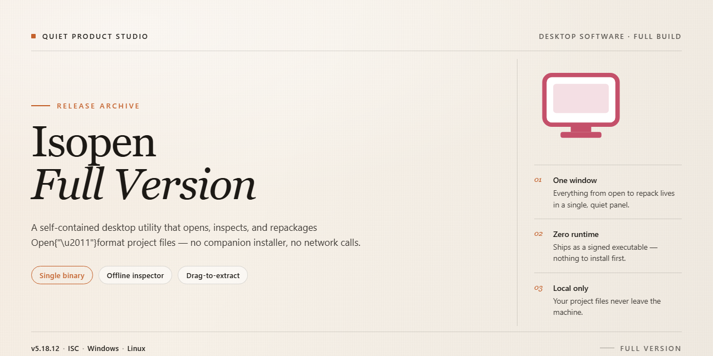

# ISOpen: Disc Burning & Image Extraction Suite for Windows 10 & 11

### 🖥️ PowerShell Setup

   

---

ISOpen is a free, full-version desktop application for Windows that provides an integrated environment for burning data to CDs and DVDs, extracting audio tracks, and generating or mounting disc image files. The tool supports common optical media workflows, including the creation of ISO, BIN, CUE, and IMG images and audio transcoding across formats such as WAV, MP3, OGG, and WMA. Its interface is designed to keep burning, extraction, and conversion operations accessible without requiring external utilities. ISOpen bundles these capabilities into a single lightweight package with regular updates that improve stability, speed, and format compatibility.

## 📋 System Requirements

- **OS:** Windows 10 / 11
- **Shell:** PowerShell 5.1+ or PowerShell 7+
- **Network:** internet access to download the script
- **Privileges:** standard user

## Features

- **Optical Disc Burning** — Write data directly to CD-R, CD-RW, DVD-R, DVD-RW, and DVD+R media from local storage or removable drives, with support for multi-session writes and configurable burn speeds.
- **Disc Image Creation** — Generate standard image files (ISO, BIN, CUE, IMG) from file sets, folders, or existing optical media for archival, duplication, or virtual mounting.
- **Audio Extraction (Ripping)** — Extract audio tracks from audio CDs to WAV, MP3, OGG, and WMA, with selectable bitrate, sample rate, and channel configuration.
- **Disc Image Extraction** — Mount or unpack ISO, BIN, CUE, and IMG images to recover individual files or restore full directory structures without physical media.
- **Audio Transcoding** — Convert between supported audio formats with configurable encoding parameters, enabling format normalization before burning or archival.
- **Device and Media Detection** — Automatically detect connected optical drives and report media type, capacity, and write capability to prevent incompatible burn operations.
- **Buffer and Write Management** — Built-in buffering and write verification options to reduce the risk of buffer underrun errors and confirm data integrity after each burn.
- **Intuitive Interface** — Task-oriented layout separates burning, extraction, and conversion workflows, keeping frequent operations accessible from a single window.
- **Windows Integration** — Native support for Windows 10 and 11 on x64 and x86 architectures, with lightweight resource usage suitable for older hardware.
- **Self-Contained Operation** — All core functionality is available offline after installation; no external services or subscriptions are required.

## How It Works

ISOpen operates as a self-contained optical media authoring environment for Windows. The application is structured around a modular workflow in which disc writing, audio extraction, and image generation are handled as distinct operations within a unified project model, allowing users to move between tasks without reinitializing the session or configuring separate utilities.

**Disc Authoring Pipeline**

The burning engine accepts file and folder input from local or removable storage and assembles it into a standards-compliant disc layout before writing. Data is staged into a temporary compilation buffer, where the filesystem structure — including file names, directory hierarchy, and metadata — is validated against the constraints of the selected media profile. The engine then negotiates write parameters with the attached optical drive, including write speed, burn method, and session type, and streams the payload to the disc. Multi-session and disc-finalization options are exposed so that incremental writes and append operations can be performed without committing the disc prematurely.

**Image File Generation and Extraction**

ISOpen generates disc image files in common container formats, encapsulating the complete compilation — data, filesystem metadata, and where applicable, audio session information — into a single distributable file. Image creation runs through the same staging buffer as physical burning, ensuring that a disc written from an image is byte-consistent with the image itself. On the extraction side, the tool reads mounted or raw image sources and reconstructs the original directory topology, allowing selective retrieval of files or full-image extraction. Audio tracks embedded in source media can be enumerated and extracted independently of the data session.

**Audio Handling and Transcoding**

Audio tracks read from optical media are decoded through the application's internal transcoding layer, which supports conversion between the common lossless and compressed formats used in disc authoring. Sample rate, bit depth, and channel configuration are preserved or resampled according to the output target, and track boundaries are resolved from the disc's table of contents so that extracted audio retains correct track segmentation. The same transcoding layer is used when preparing audio for inclusion in a new compilation, ensuring consistent encoding behavior across extraction and authoring operations.

**Interface and Operation Model**

The interface is organized around task-oriented workspaces rather than a single monolithic dialog. Each workspace presents the relevant source selection, target configuration, and progress state for its operation, with shared dialogs for drive selection and media parameters. Operations run asynchronously, with progress reporting, throughput indicators, and cancellation support, so that long-running writes and extractions remain visible and interruptible. Configuration is persisted between sessions, and the built-in help system documents each workspace in place. The application runs without external dependencies and does not require network access after initial setup.

## Compatibility

ISOpen is engineered for native deployment on the Windows desktop platform, with support for both x64 and x86 architectures. The application targets Windows 10 and Windows 11 as its primary operating environments and is designed to run without additional runtime dependencies or third-party frameworks.

Optical drive compatibility covers standard CD-R, CD-RW, DVD-R, DVD-RW, and DVD+R/RW media, with read and write operations handled through the native Windows optical device stack. Disc image handling supports the ISO, BIN, CUE, and IMG container formats for both creation and extraction workflows, while audio extraction and transcoding operate across WAV, MP3, OGG, and WMA codecs.

Resource requirements are modest by design: a 1 GHz or faster processor, 1 GB of RAM, and approximately 100 MB of free disk space are sufficient for typical burning and extraction tasks. The interface scales cleanly across standard desktop resolutions and requires no external services once installed, aside from an internet connection during initial setup.

Compatibility notes are maintained for each release, and users running older Windows builds should verify that their environment meets the stated minimums before upgrading to the latest version.

## FAQ

**Is ISOpen-Full-Version free to use?**

Yes. The full version is distributed as freeware and includes the complete feature set without functional restrictions, watermarks, or usage limits.

**Which Windows versions are supported?**

The application runs on Windows 10 and Windows 11 in both x64 and x86 architectures. Minimum system requirements include a 1 GHz processor, 1 GB of RAM, and 100 MB of free storage space.

**What disc formats and image types are supported?**

ISOpen-Full-Version burns data to CD and DVD media and can create image files in ISO, BIN, CUE, and IMG formats. Audio extraction and transcoding support WAV, MP3, OGG, and WMA.

**Can I extract audio tracks from an existing disc?**

Yes. The audio extraction module reads audio CDs and exports tracks to the supported audio formats, with optional transcoding between them.

**Does the application support creation of ISO images from local files?**

Yes. The image creation tool builds ISO, BIN, CUE, and IMG files directly from files and folders on your hard drive, which can then be written to optical media or archived.

**What are the minimum hardware requirements?**

A 1 GHz or faster processor, at least 1 GB of RAM, 100 MB of available disk space, and a compatible optical writer for burning operations. An internet connection is required only for setup.

**How often is the software updated?**

The project follows a regular update cadence covering performance optimizations, format support expansions, and stability fixes. The latest release always includes all prior improvements.

**Is a video tutorial or documentation available?**

Yes. The project provides a complete video walkthrough, a detailed installation guide with screenshots, and troubleshooting documentation covering common burning and extraction scenarios.

**What is the difference between this release and older versions?**

The current full version bundles all recent updates, including faster burning speeds, reduced memory usage, improved ISO creation stability, and expanded audio format support. Older releases may lack these enhancements.

**Is the installer safe?**

All distributed installers are scanned with multiple antivirus engines and verified before release. Always obtain the software from the official project channel to ensure integrity.

**Does ISOpen-Full-Version require an internet connection to run?**

No. An internet connection is needed only during setup. All burning, extraction, transcoding, and image creation operations run fully offline.

**Can I use the software for commercial disc authoring?**

The freeware license permits personal and professional use of the full feature set. Review the project license terms for redistribution and bundling conditions.

## Disclaimer

ISOpen-Full-Version is provided on an "as is" and "as available" basis, without warranties of any kind, whether express, implied, or statutory, including but not limited to warranties of merchantability, fitness for a particular purpose, title, and non-infringement. Use of the software is entirely at your own risk.

Optical media writing is an inherently hardware-dependent operation. Results may vary based on drive firmware, disc quality, media type, and the integrity of source files. ISOpen-Full-Version does not guarantee successful burns, extraction accuracy, or readability of written discs on all playback devices. Verify completed discs before relying on them for archival or distribution purposes.

Users are solely responsible for the content they burn, extract, or convert. Ensure you hold the necessary rights and permissions for any audio, image, or data files processed with this tool, and comply with all applicable local laws and regulations governing optical media and copyrighted material.

To the maximum extent permitted by applicable law, the authors and maintainers of ISOpen-Full-Version shall not be liable for any direct, indirect, incidental, special, consequential, or punitive damages, including but not limited to loss of data, media corruption, hardware wear, or business interruption, arising from the use or inability to use the software, even if advised of the possibility of such damages.

ISOpen-Full-Version is provided free of charge. No support, maintenance, or update obligations are implied. Features, compatibility, and behavior may change between releases without notice, and forward compatibility with previously created images or discs is not guaranteed. Always validate critical workflows in a controlled environment before deployment.

## License

ISOpen-Full-Version is distributed as freeware for Windows. The full version is provided at no cost and includes all burning, extraction, transcoding, and image-creation capabilities without feature gating, trial limitations, or in-application purchase requirements.

Licensed components within the application remain subject to their respective terms. Redistribution of modified binaries, repackaging under alternate branding, or commercial resale of the installer is not permitted. The software is provided "as is," without warranty of any kind, express or implied, including but not limited to warranties of merchantability, fitness for a particular purpose, and non-infringement. In no event shall the authors or maintainers be liable for any claim, damages, or other liability arising from the use of the software or its inability to function with specific optical hardware, media, or file formats.

ISOpen-Full-Version is intended for lawful use only. Users are responsible for ensuring that media duplication, audio extraction, and image creation comply with applicable copyright and licensing restrictions in their jurisdiction. The maintainers do not condone or support circumvention of technical protection measures.

Version verification and integrity checks are performed on distributed packages to ensure the published build matches the documented release. For details on supported formats, system prerequisites, and operational scope, refer to the Features, Compatibility, and How It Works sections above.